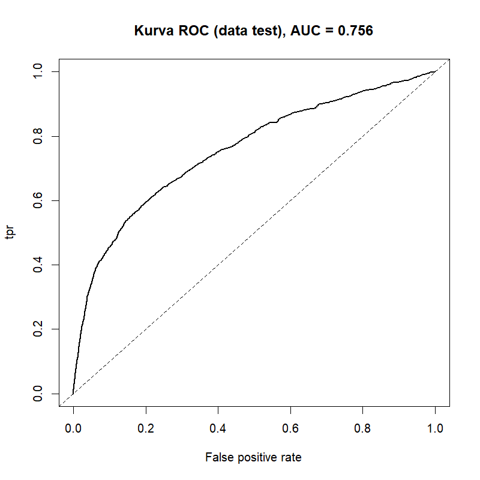

# Pemodelan Probability of Default dengan Regresi Logistik dan Implementasi Newton-Raphson
Proyek ini memodelkan peluang nasabah kartu kredit gagal bayar (*probability of default*, PD) dan mengimplementasikan estimasinya dengan Newton-Raphson yang ditulis sendiri di R dan dicocokkan dengan 'glm()', bukan hanya memakai fungsi bawaan R. Mencakup seleksi variabel dengan Weight of Evidence (WoE) dan Information Value (IV), estimasi regresi logistik dengan metode Newton-Raphson yang ditulis sendiri, dan evaluasi pada data uji.

**Penulis:** Hilmiya Fahimah, Program Studi Matematika, Universitas Jenderal Soedirman.

## Data
*Default of Credit Card Clients*, UCI Machine Learning Repository
(30.000 nasabah kartu kredit di Taiwan, April–September 2005; tingkat gagal bayar 22,1%).
Lisensi CC BY 4.0.

Sitasi: Yeh, I. (2009). *Default of Credit Card Clients* [Dataset].
UCI Machine Learning Repository. https://doi.org/10.24432/C55S3H

Data tidak disertakan di repositori ini. Unduh dari
https://archive.ics.uci.edu/dataset/350/default+of+credit+card+clients,
lalu simpan file Excel-nya di folder `data/` dengan nama
`default of credit card clients.xls`.

## Cara menjalankan
Buka folder proyek di RStudio (sebaiknya sebagai RStudio Project), lalu jalankan
script berurutan. Paket yang dibutuhkan: `readxl` (dan `pROC` sebagai pembanding opsional).

| Urutan | Script | Isi |
|---|---|---|
| 1 | `R/01_data.R` | Baca data, bersihkan kode kategori, bagi data menjadi 70% train lalu 30% test dengan proporsi gagal bayar yang sama di keduanya (stratified) |
| 2 | `R/03_woe_iv.R` | Pengelompokan variabel, WoE dan IV, verifikasi IV = divergensi Jeffreys |
| 3 | `R/05_seleksi_glm.R` | Seleksi variabel dengan VIF, regresi logistik dengan `glm()` sebagai acuan |
| 4 | `R/05b_cek_pay2.R` | Perbandingan model dengan dan tanpa `PAY_2` (AIC, BIC, uji rasio likelihood) |
| 5 | `R/06_newton_raphson.R` | Regresi logistik dari nol dengan Newton-Raphson, verifikasi terhadap `glm()` |
| 6 | `R/07_evaluasi.R` | AUC, Gini, KS, kalibrasi pada data uji |

Script pendukung: `R/fungsi.R` (fungsi yang digunakan pada script 03 dan 05, dipanggil dengan `source()`),
`R/04_cek_pay.R` (pemeriksaan nilai status pembayaran),
`R/02_markov.R` dan `R/02b_markov_ringkas.R` (eksplorasi rantai Markov dua state, bersifat ilustratif).

## Hasil utama
| Data | AUC | Gini | KS |
|---|---|---|---|
| Train | 0,7699 | 0,5398 | 0,4167 |
| Test | 0,7557 | 0,5114 | 0,3955 |

- IV `PAY_0` = 0,8983. Nilai IV = D_KL(g‖b) + D_KL(b‖g) diverifikasi secara numerik (0,8983076 untuk keduanya).
- VIF maksimum 2,66 (batas yang dipakai: 5). `PAY_2` dibuang dari model akhir
  (AIC dan BIC tidak searah, uji rasio likelihood p = 0,013, dan koefisiennya bertanda positif, berlawanan dengan variabel lain).
- Koefisien Newton-Raphson buatan sendiri berbeda dari `glm()` hanya sekitar 1 × 10⁻⁸; log-likelihood sama (−9152,075).
- AUC dari tiga cara (peringkat/Mann-Whitney, pasangan langsung, `pROC`) sama: 0,7557093.

## Catatan data dan keterbatasan
- Data kartu kredit Taiwan tahun 2005, bukan data perbankan Indonesia.
- Definisi gagal bayar tidak dirinci pada dokumentasi sumber.
- Nilai status pembayaran `PAY_` -2 dan 0 tidak didefinisikan di dokumentasi; tafsirannya adalah asumsi.
  Nilai 1 hampir tidak muncul di `PAY_2`–`PAY_6`, sedangkan ada ribuan di `PAY_0`; penyebabnya tidak diketahui.
- `SEX` dan `MARRIAGE` tidak dimasukkan ke model karena pertimbangan etika.
- Evaluasi memakai satu kali pembagian data latih dan uji, sehingga hasilnya belum diuji kestabilannya pada pembagian lain.
- Peluang gagal bayar hasil model secara umum sesuai dengan kenyataan, tetapi di beberapa kelompok nasabah masih ada selisih beberapa poin persentase.
- Analisis rantai Markov hanya eksplorasi awal dan tidak dijadikan dasar kesimpulan.
